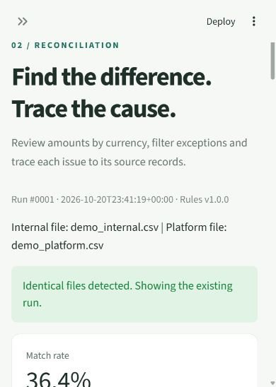

# LedgerMatch

**Transaction reconciliation and exception reporting with Python, pandas, SQLite and Streamlit.**

[](https://github.com/ye11122233/ledger-match/actions/workflows/tests.yml)


LedgerMatch compares internal transaction records with payment-platform CSV exports, identifies discrepancies and preserves a traceable processing history. This portfolio project uses synthetic data and an English interface.

## What it does

- Validates CSV fields, dates, currencies and amounts, and isolates duplicate transaction keys.
- Matches on transaction ID and currency to find amount mismatches and transactions missing from either source.
- Displays match rates and currency-specific differences, with filters and downloadable exception reports.
- Preserves original rows, validation issues and reconciliation history in SQLite.
- Detects identical imports using content hashes and saves each run in one database transaction.

Amounts use integer cents. Duplicate or invalid keys are blocked for investigation; records are not silently discarded. Reports separate net differences, absolute differences and missing-side amounts so offsetting errors remain visible.

## Application preview



*Actual local application screenshot. Resize the browser panel to see the full dashboard layout.*

## Run locally

Python **3.12** is the tested version. Install dependencies before the first run.

```sh
git clone https://github.com/ye11122233/ledger-match.git
cd ledger-match/transaction-reconciliation
```

**Windows (PowerShell)**

```powershell
py -3 -m venv .venv
.\.venv\Scripts\python.exe -m pip install -r requirements.txt
.\.venv\Scripts\python.exe -m streamlit run app.py
```

**macOS / Linux**

```sh
python3 -m venv .venv
.venv/bin/python -m pip install -r requirements.txt
.venv/bin/python -m streamlit run app.py
```

Open `http://127.0.0.1:8501` on the computer running the app. This is a local address, not a hosted demo. On Windows, `start.cmd` can also create the environment, install dependencies when needed and start the app.

Select **Run demo** for the exception dataset. Then choose **Corrected data** and compare the saved runs in **History**. No credentials or external payment services are needed.

## Example investigation

The exception fixture contains 15 internal rows and 13 platform rows. Its independently specified results are 4 matched keys, 3 amount mismatches, 4 missing-side keys and 4 blocked keys. One additional invalid row has no transaction ID and appears in the validation report.

Two GBP mismatches have differences of +1.00 and -1.00. Their net difference is zero, while their absolute difference is 2.00: comparing totals alone would miss both errors. The corrected fixture represents a human-reviewed outcome and matches all 15 keys.

## Tests

From `transaction-reconciliation`, run:

```powershell
# Windows
.\.venv\Scripts\python.exe -m unittest discover -s tests -v
```

```sh
# macOS / Linux
.venv/bin/python -m unittest discover -s tests -v
```

The suite contains **52 unit, integration and Streamlit interaction tests**, including decimal precision, duplicate imports, transactional rollback, English reports and original-record tracing. GitHub Actions runs the suite on Windows and Linux for pushes and pull requests to `main`; the badge above shows the latest workflow status.

A recorded local synthetic benchmark reconciled **10,000 transaction keys across 19,800 source records** in approximately **0.37 seconds**, including validation, matching and SQLite persistence. This was one local run, excludes browser rendering, and is not a production capacity claim. See the [verification report](transaction-reconciliation/docs/VERIFICATION.md) for its scope.

## Explore the project

| Resource | Contents |
|---|---|
| [Application documentation](transaction-reconciliation/README.md) | Input schema, business rules, architecture and setup |
| [Demo and interview guide](transaction-reconciliation/docs/DEMO_GUIDE.md) | Walkthrough, SQL examples and implementation decisions |
| [Tests](transaction-reconciliation/tests/) | Executable behavior and boundary checks |
| [Sample data](transaction-reconciliation/sample_data/) | Exception and corrected CSV pairs with expected results |
| [Database schema](transaction-reconciliation/reconciliation/schema.sql) | Tables, constraints, relationships and indexes |

## Scope

Both exports must cover the same period and definition of completed gross transaction amounts. The current version supports GBP, EUR and USD. Refunds, fees, FX conversion and settlement timing are outside its scope. It is a local, single-user portfolio application.
